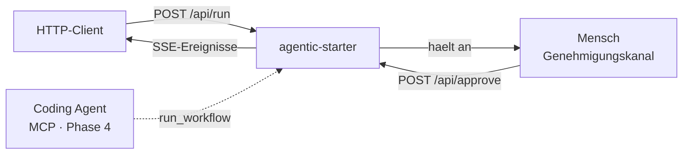
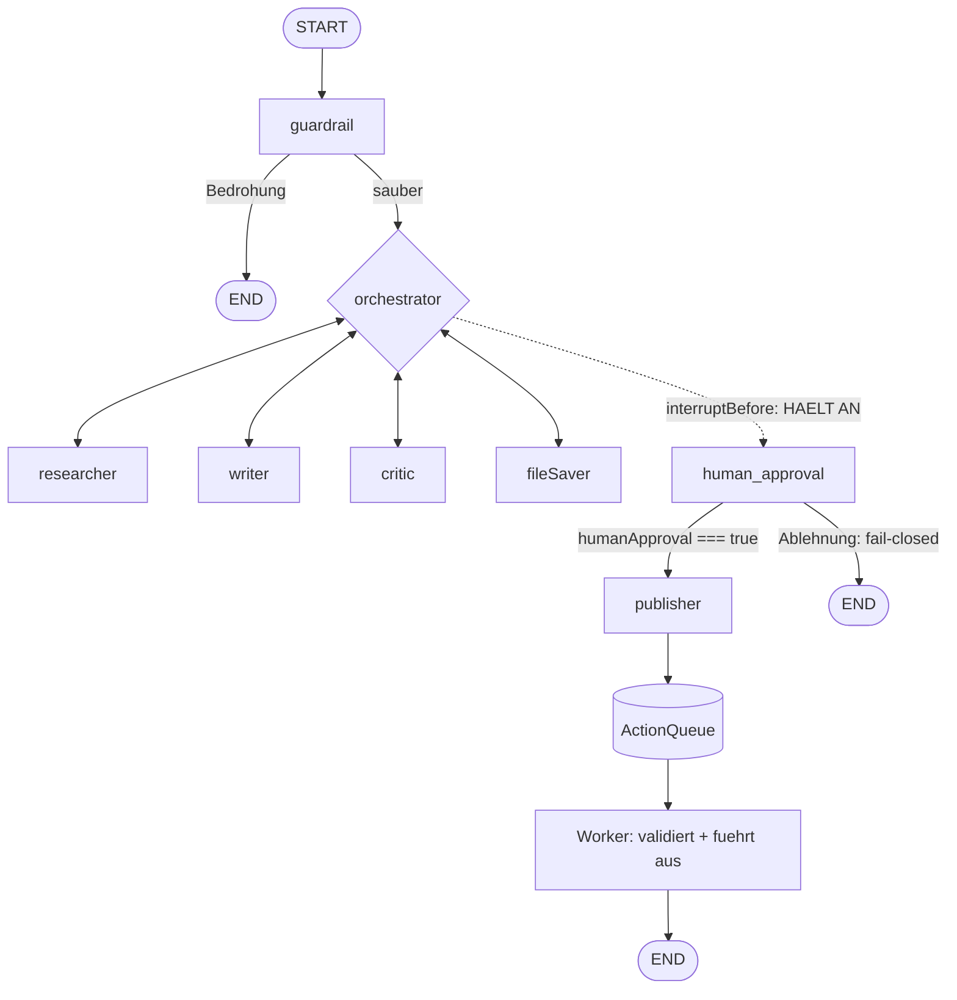
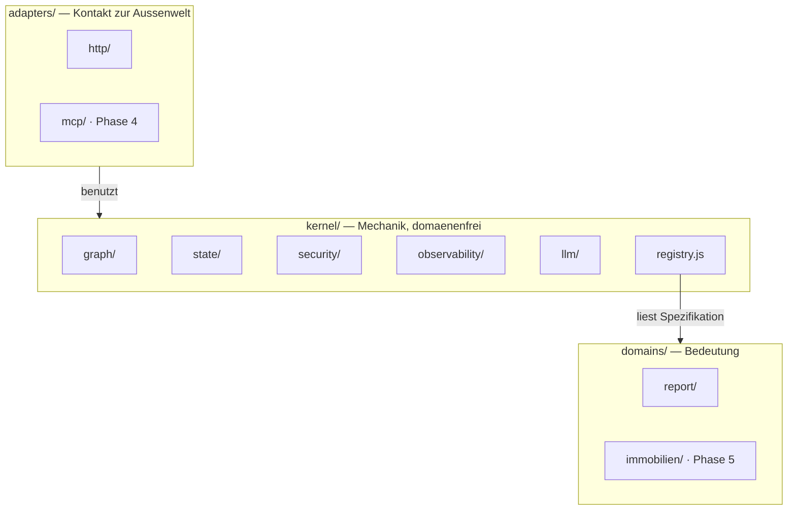
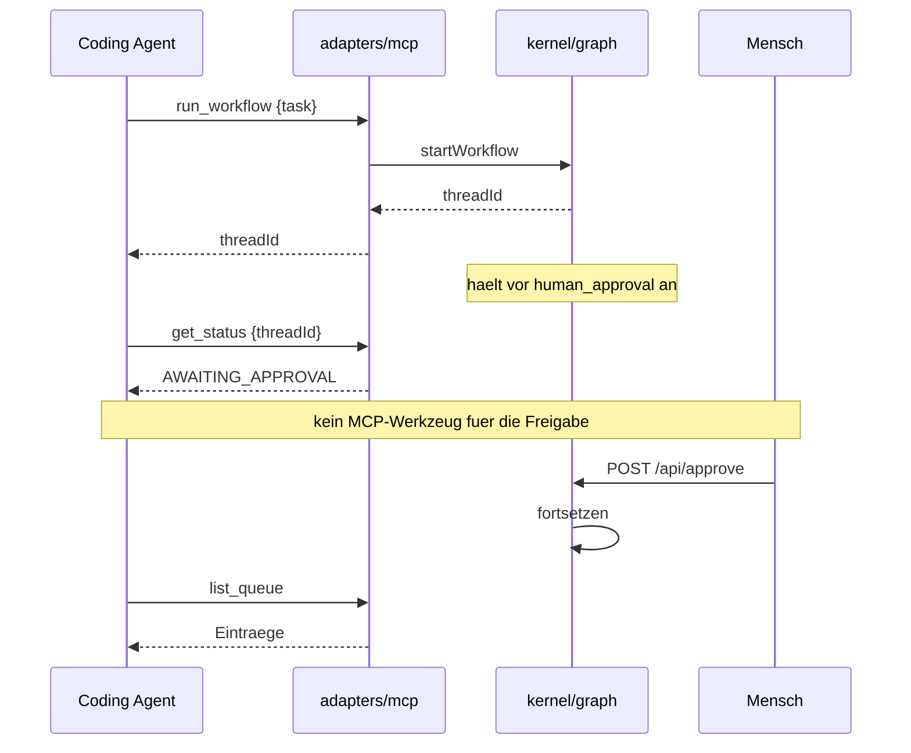

# ARCHITECTURE — agentic-starter

> Wie das System gebaut ist, warum es so gebaut ist, und wo seine Grenzen liegen.
> Einzelne Entscheidungen mit ihrer Begründung stehen in `DECISIONS.md`; hier steht
> das Gesamtbild.

**Stand:** Phase 1 · **Zuletzt aktualisiert:** 2026-09-02

---

## 1. Topologie

### Abb. 1 · Kontext — wer mit dem System spricht



Der MCP-Kanal ist gestrichelt: er entsteht in Phase 4 (ADR-0022) und traegt bewusst
**kein Genehmigungswerkzeug**. Die Freigabe bleibt auf einem Kanal, den kein Agent bedient.

### Abb. 3 · Graph-Topologie



Die Kante `human_approval → publisher` ist **bedingt und fail-closed** (Phase 2, T2.3):
nur `humanApproval === true` führt zum `publisher`, alles andere — auch `null` — nach END.
Das Sequenzbild dazu steht in `docs/workflow.md` (Abb. 4).

Drei Schichten, die sich nicht vermischen:

| Schicht | Verantwortung | Dateien |
|---|---|---|
| **HTTP** | Eingang, Auth, Rate-Limit, SSE | `src/adapters/http/server.js`, `src/kernel/security/` |
| **Orchestrierung** | Graph, Routing-Verfahren, Pause/Fortsetzung | `src/kernel/graph/` · Bremsenreihenfolge in `src/domains/report/domain.js` |
| **Agenten** | je eine fachliche Aufgabe | `src/domains/<domäne>/agents/*.js` |

## 2. Kernentscheidungen

### 2.1 Hub-and-Spoke statt Kettenlogik

Jeder Agent kehrt zum `orchestrator` zurück; die Kante sagt nur „geh dahin, was
`state.nextAgent` sagt". Die gesamte Routing-Intelligenz sitzt in **einem** Knoten.

**Trade-off:** Ein zusätzlicher Knotendurchlauf pro Schritt — mehr Latenz und, wenn die
LLM-Schicht greift, mehr Token. Dafür ist die Frage „warum ging es dorthin?" an genau einer
Stelle beantwortbar. Bei einer Kettenlogik wäre die Antwort über alle Kanten verstreut.

**Warum das überwiegt:** Die Prüfbarkeit ist hier das Produkt. Ein Muster, dessen Routing
man nicht an einer Stelle lesen kann, taugt nicht als Vorlage.

### 2.2 Dreischichtiges Routing: deterministisch zuerst

```
1. BREMSEN (Code)        → lösen die meisten Fälle, null LLM-Kosten
2. LLM (Zod-Schema)      → nur wenn keine Bremse greift
3. Post-LLM-Validierung  → ungültiger Agent → Override auf END
```

Die sieben Bremsen in `orchestrator.js` sind **geordnet**; die Reihenfolge ist die Regel:

| # | Bedingung | Ziel |
|---|---|---|
| 1 | bereits veröffentlicht | `END` |
| 2 | Datei gespeichert, keine menschliche Entscheidung | `human_approval` |
| 3 | Revisionslimit erreicht (`>= 5`) | `human_approval` |
| 4 | keine Recherche | `researcher` |
| 5 | Recherche da, kein Entwurf | `writer` |
| 6 | Entwurf da, keine Freigabe | `critic` |
| 7 | freigegeben, nicht gespeichert | `fileSaver` |

**Trade-off:** Deterministische Regeln sind starr; ein Fall außerhalb der Bremsen landet beim
LLM, und dessen Antwort ist nicht garantiert gültig. Deshalb Schicht 3: der gewählte Agent
wird gegen `VALID_AGENTS` geprüft und sonst auf `END` überschrieben.

**Die Leitidee:** Das LLM ist Geschworener, nicht Richter. Sicherheitsrelevante Übergänge —
allen voran die Übergabe an den Menschen — sind **niemals** dem Modell überlassen.

### 2.3 Reducer-Semantik trägt Bedeutung

`src/kernel/state/reducers.js` kennt drei Reducer, und die Wahl ist eine fachliche Aussage:

| Reducer | Verhalten | Für welche Felder | Warum |
|---|---|---|---|
| `keepIfFilled` | leeres Schreiben überschreibt nicht | `research`, `draft` | Ein Agent, der `""` liefert, soll eine gute Vorstufe nicht zerstören |
| `lastWins` | letzter Wert gewinnt | `nextAgent`, `isApproved`, Flags | Entscheidungsfelder müssen auch auf „leer" zurücksetzbar sein |
| `sum` | akkumuliert | `revisionCount` | Der Zähler ist der Schutzschalter |

**Bekannter Fehler in dieser Zuordnung:** `criticFeedback` liegt auf `keepIfFilled`, ist
aber ein Entscheidungsfeld. Der Critic setzt es nach einer Freigabe bewusst auf `""` — der
Reducer schluckt das, und veraltete Kritik bleibt stehen. Gehört auf `lastWins`
(siehe `DECISIONS.md`, ADR-0007).

### 2.4 HITL: eine Zustandsmaschine zwischen zwei HTTP-Anfragen

`interruptBefore: ["human_approval"]` lässt den Graphen anhalten, **bevor** er den Knoten
betritt. Der Zustand liegt im Checkpointer. Die zweite Anfrage (`/api/approve`) schreibt die
Entscheidung mit **derselben `thread_id`** in denselben Checkpoint und setzt fort.

**Trade-off:** Der gesamte Ablauf hängt an der `thread_id`. Geht sie verloren, ist der
Workflow unerreichbar — er läuft nicht falsch weiter, er ist einfach nicht mehr adressierbar.
Der Preis für die Einfachheit: kein Wiederfinden über Inhalte, nur über den Schlüssel.

### 2.5 Aktions-Isolation: Agenten rufen keine APIs auf

Der `publisher` **schreibt nur in eine Queue**. Der echte externe Aufruf passiert in einem
separaten Worker, der noch einmal validiert.

Zwei Tore:

1. `enqueueAction` — steht der `actionType` nicht auf der Whitelist
   (`NOTIFY`, `WEBHOOK`, `EMAIL`), wird schon vor dem Schreiben abgelehnt.
2. Der Worker — prüft das Payload gegen einen typspezifischen Validierer.

**Warum das das wichtigste Muster ist:** Ein gekaperter oder halluzinierender Agent kann
damit weder Daten abfließen lassen noch spammen. Er kann nur schemabegrenzte Einträge in eine
Queue legen. Die Angriffsfläche schrumpft von „alles, was das Netz erlaubt" auf „drei
validierte Formen".

### 2.6 Mock-Modus als Fundament, nicht als Notlösung

Ohne `ANTHROPIC_API_KEY` läuft der komplette Ablauf mit deterministischen Fake-Antworten.

**Das ist eine Architekturentscheidung, keine Bequemlichkeit:** Tests und die Evaluationen
der Schicht A laufen dadurch kostenlos, reproduzierbar und in CI. Der Preis ist ehrlich zu
benennen — sie messen **Routing- und Richtlinienkorrektheit, nicht LLM-Ausgabequalität**.
Diese Unterscheidung gehört in jede Diskussion über die Aussagekraft der Zahlen. Die
Ausgabequalität misst seit ADR-0019 die Schicht B gegen ein echtes Modell (`EVALS.md` §1–2).

### 2.7 Event-Buffering gegen eine echte Race-Condition

Der Workflow beginnt Events zu erzeugen, bevor der Browser die SSE-Verbindung geöffnet hat.
`lib/eventBus.js` puffert deshalb, solange kein Zuhörer da ist, und spielt beim Verbinden ab.

**Trade-off:** Ein Puffer, den niemand abholt, ist ein Speicherleck. Deshalb ein GC nach
5 Minuten — der allerdings nur am Ende von `startWorkflow` angestoßen wird und den
HITL-Pfad nicht abdeckt (bekannte Grenze, siehe §4).

## 3. Datenfluss eines Laufs

```
task ──guardrail──→ threatScore, ggf. bereinigter task
     ──researcher─→ research
     ──writer─────→ draft, revisionCount +1, isApproved = null
     ──critic─────→ isApproved, criticFeedback
     ──fileSaver──→ fileSaved = true, Artefakt im Store
     ──[HITL]─────→ humanApproval
     ──publisher──→ isPublished = true, Eintrag in der ActionQueue
```

Jeder Schritt schreibt zusätzlich in `log[]`; der Runner sendet daraus SSE-Events. Der Log
ist die Trace-Grundlage — ohne ihn wäre keine Evaluation überprüfbar.

## 4. Bekannte Grenzen

Diese Liste ist Teil der Architektur, nicht ihr Anhang. Wer auf diesem Repo aufbaut, muss
sie kennen.

| Grenze | Auswirkung | Geplant |
|---|---|---|
| `MemorySaver` im Arbeitsspeicher | Bei einem Neustart gehen auf HITL wartende Workflows verloren | Phase 5 |
| Artefakt-Store ist eine `Map` | Dasselbe für gespeicherte Berichte | Phase 5 |
| Action-Executor simuliert | Es wird nichts wirklich zugestellt | Phase 5 |
| Ein einziger Tenant | Kein `tenantId` in Abfragen, keine Mandantentrennung | Feld ab Phase 5 im Schema (ADR-0025), Trennung Phase 6 |
| Puffer-GC deckt den HITL-Pfad nicht ab | Kleines Speicherleck bei langlaufenden Servern | Phase 2 |
| `res.content` wird als String angenommen | Im echten LLM-Modus möglich: `[object Object]` | Phase 2 |
| Guardrail-Schwelle unerreichbar | Blockierschwelle 8 = Summe aller Gewichte; eine einzelne Injection wird nur sanitisiert. **Gemessen in Phase 3:** 3.5 steht auf einem Nenner von 1 | offen |
| `scheduleBufferGc` hält den Prozess offen | Der 5-Minuten-Timer ist nicht `unref`'t; ein Node-Prozess endet danach erst verspätet. In Tests mit `--test-force-exit` umgangen | offen |
| Keine Kontextstrategie | Nur Zählung (`estTokens`), kein Komprimieren oder Kürzen — bei langen Sitzungen wächst der Kontext ungebremst | messen Phase 3 (`EVALS.md` §3.12), lösen Phase 6 — und nur, wenn die Messung Last zeigt |

### Blockierende Defekte (Baseline, Phase 0)

Drei davon waren keine Grenzen, sondern Fehler. Sie standen absichtlich offen, damit ihre
Behebung messbar wird (`PRODUCT.md` §6.1):

1. ~~**Bremse 6 unterscheidet nicht zwischen „ungeprüft" und „abgelehnt".**~~
   **Behoben in Phase 2 (T2.2):** die Bremse ist geteilt — 6a (`isApproved == null`)
   führt zum `critic`, 6b (`isApproved === false`) zurück zum `writer`. Damit greift
   auch Bremse 3 wieder, weil `revisionCount` nun wächst. Verifiziert durch Ausführen:
   `npm run demo` endet mit Exit 0 und `PUBLISHED`.
2. ~~**Die Kante `human_approval → publisher` ist unbedingt.**~~ **Behoben in Phase 2
   (T2.3):** die Kante ist bedingt und fail-closed. Verifiziert durch Ausführen — nach
   `approved:false` bleibt das Artefakt `AWAITING_APPROVAL` und die Queue ist leer.
3. ~~**`sanitizeApiKey` entfernt ungültige Zeichen, statt abzulehnen.**~~ **Behoben in
   Phase 2 (T2.4):** das Format wird geprüft statt bereinigt, ungültige Eingaben ergeben
   401, und der Vergleich läuft laufzeitkonstant. Verifiziert durch Ausführen in acht
   Fällen. `req.clientId` trägt jetzt den gesendeten Wert.

## 5. Was sich als Nächstes ändern wird

**Ausführungsreihenfolge seit ADR-0024: `2 → 3 → 5 → 4 → 6`.** Die Nummern bleiben, das
Produkt rückt vor die Veröffentlichung. Die folgende Liste steht in Ausführungsreihenfolge.

- **Phase 2:** die drei blockierenden Defekte sind behoben (T2.2, T2.3, T2.4) und durch
  Ausführen verifiziert. `kernel/observability/trace.js` steht seit T2.5 **am Zielort**
  (§6) — damit existiert `src/kernel/` erstmals, und jeder Lauf hinterlässt eine
  JSONL-Datei unter `evals/traces/`. Offen bleiben die kleineren Grenzen mit dem Vermerk
  „Phase 2" und der Teil ohne Code: Kundenerkundung und die **Zeit-Baseline des manuellen
  Prozesses**, die erhoben sein muss, bevor das System steht (`PRODUCT.md` §6.1, T13).
- **Phase 3** ist abgeschlossen: Tests (T3.1), der Umzug in die Zielstruktur (ADR-0023) und
  das Harness der Schicht A (T3.3) stehen, das minimale CI ist geschrieben. Die Topologie hat
  sich beim Umzug nicht geändert — dieselben Tests lieferten davor und danach dasselbe
  Ergebnis. Offen bleibt nur der erste CI-Lauf.
- **Phase 5 hat die Domäne `immobilien` aufgenommen** (ADR-0020, vorgezogen durch
  ADR-0024) und damit erstmals das Prüfkriterium aus ADR-0018 durchlaufen — beim
  Aufnehmen der Domäne änderte sich unter `src/kernel/` **keine Zeile** (T10, verifiziert
  2026-09-03). Das Skelett (`portfolioLoader → listingWriter ⇄ contractChecker →
  listingStore → human_approval → delivery`, §6) läuft Ende-zu-Ende gegen eine
  Entwicklungs-Fixture (`npm run demo:immobilien`). Offen bleiben Persistenz
  (Checkpointer und Artefakt-Store, mit `tenantId` nach ADR-0025, T11), der erste echte
  Executor, ein schlanker Genehmigungsbildschirm, und T12 — ein echter, von einer
  Beraterin oder einem Berater genehmigter Lauf gegen einen echten Portfolio-Datensatz.
- **Phase 4** stellt den MCP-Server daneben (§7, ADR-0022) — derselbe Kern, zweiter Kanal —
  und ergänzt die Judge-Maschine der Schicht B sowie die Fallstudie, die jetzt echte
  Zahlen hat.
- **Phase 6** beginnt nur, wenn ein zweiter Kunde oder eine zweite Vertikale sie auslöst:
  Mandantentrennung, zweite Domäne, Kontextstrategie (nur wenn `EVALS.md` §3.12 Last
  zeigt), Konnektoren, MCP-Client.

## 6. Zielstruktur: Kern, Domänen, Adapter

Festgelegt in ADR-0023, **gebaut in Phase 3**. Die 19 bestehenden Dateien sind umgezogen,
nachdem die Tests als Netz standen; dieselben Tests lieferten davor und danach dasselbe
Ergebnis. Der Baum unten zeigt den **Ist-Zustand**, nicht mehr eine Absicht.

### Abb. 2 · Die drei Ringe



Die Pfeile gehen nur in eine Richtung. Eine Domäne kennt keinen Adapter, und der Kern kennt
keine einzelne Domäne — er kennt nur die Registry.

### Der Zielbaum

```
src/
├── kernel/                     ≤ 20 Dateien (ADR-0021) · heute 16
│   ├── graph/
│   │   ├── build.js            StateGraph aus einer Domänen-Spezifikation
│   │   ├── runner.js           Pause und Fortsetzung, Checkpointer
│   │   └── routing.js          das Verfahren des dreischichtigen Routings
│   ├── state/
│   │   ├── reducers.js         keepIfFilled · lastWins · sum
│   │   └── schema.js           Kernfelder + Erweiterungspunkt der Domäne
│   ├── security/
│   │   ├── auth.js
│   │   ├── rateLimiter.js
│   │   ├── actionQueue.js      Queue-Mechanik
│   │   └── guardrail.js        Regex-Engine
│   ├── observability/
│   │   ├── trace.js            ✅ Phase 2 (T2.5) · run_id, JSONL je Lauf
│   │   ├── eventBus.js
│   │   └── costTracker.js
│   ├── llm/
│   │   ├── adapter.js          einziger LLM-Eingang + Beobachter je Aufruf (3.12)
│   │   └── mock.js            deterministische Fake-Antwort, Token-Schätzung
│   ├── config/
│   │   └── env.js             Umgebungsvariablen an einer Stelle
│   └── registry.js             Domänen-Registrierung — Konfiguration, kein Code
│
├── domains/
│   ├── report/
│   │   ├── domain.js           Spezifikation: Agenten, Bremsenreihenfolge, State-Felder
│   │   ├── agents/             researcher · writer · critic · fileSaver · publisher
│   │   ├── prompts.js          alle Prompts der Domäne an einer Stelle
│   │   └── actions.js          erlaubte Aktionstypen + Payload-Schemata
│   │                           (contract.js — Ausgabevertrag, ADR-0019 — erst Schicht B)
│   └── immobilien/             ✅ Phase 5 (T10) — zweite Domäne, 0 Zeilen unter kernel/
│       ├── domain.js           Spezifikation: portfolioLoader → listingWriter ⇄
│       │                       contractChecker → listingStore → delivery
│       ├── agents/             portfolioLoader · listingWriter · contractChecker ·
│       │                       listingStore · delivery
│       ├── prompts.js          Prompts je Agent/Portal
│       ├── actions.js          Whitelist: PUBLISH_LISTING
│       └── data/portfolioFixture.js  Entwicklungs-Fixture — KEIN echter Datensatz (T12 offen)
│
├── adapters/
│   ├── http/
│   │   └── server.js           Routen; `listen` steht in bin/serve.js
│   └── mcp/                    ⏳ Phase 4 (ADR-0022)
│
└── bin/
    ├── demo.js
    ├── demoImmobilien.js       ✅ Phase 5 — golden path der Domäne immobilien
    └── serve.js
```

### Die Naht ist an drei Stellen fein

Hier entscheidet sich, ob der Kern domänenfrei bleibt. Wer diese drei verwechselt, hat die
Behauptung aus ADR-0018 verloren, ohne es zu merken.

| Gehört in den Kern | Gehört in die Domäne |
|---|---|
| Das **Verfahren** des Routings: Code zuerst, dann LLM, dann Validierung | Die **Reihenfolge der sieben Bremsen** — sie beschreibt den Berichtsablauf |
| Die **Regex-Engine** des Guardrails | Die **Muster**, gegen die geprüft wird |
| Die **Mechanik** der Action-Queue: einreihen, validieren, ausführen | Die **Whitelist** `NOTIFY`/`WEBHOOK`/`EMAIL` und ihre Payload-Schemata |

> **Zwei bewusste Abweichungen vom ursprünglichen Entwurf.** `config/env.js` fehlte im
> gezeichneten Baum, gehört aber in den Kern — Umgebungslesen ist Mechanik. Und aus `prompts/`
> wurde `prompts.js`: für drei Prompts ein Verzeichnis anzulegen wäre Struktur ohne Inhalt.

### Prüfkriterium des Umzugs

**Dieselben Tests liefern vor und nach dem Umzug dasselbe Ergebnis.** Damit ist er eine
Refaktorierung im Wortsinn — keine Änderung, die sich als Aufräumen tarnt. Das zweite,
längerfristige Kriterium steht in ADR-0018: eine zweite Domäne darf **null Zeilen** in
Kerndateien ändern — **verifiziert in Phase 5 (T10, 2026-09-03):** die Domäne `immobilien`
entstand als Geschwisterdatei zu `domains/report/`, `src/kernel/` blieb unangetastet.

## 7. MCP als Adapter

Festgelegt in ADR-0022: **Server in Phase 4, Client in Phase 5.** Der Server ist ein reiner
Adapter über demselben Kern, den auch HTTP benutzt — und damit zugleich der Beweis, dass die
Adapternaht trägt: zwei Kanäle, ein Kern, kein doppelter Ablaufcode.

Angebotene Werkzeuge: `run_workflow`, `get_status`, `list_queue`.

> **Nicht angeboten: `approve`.** Böte man die Freigabe als Werkzeug an, könnte derselbe
> Agent, der den Lauf startet, seine eigene Aktion genehmigen. Die zentrale Zusage dieses
> Repos wäre genau dort gebrochen, wo sie am sichtbarsten ist. Die Freigabe bleibt auf einem
> Kanal, den kein Agent bedient.

### Abb. 7 · Ein Lauf über MCP, mit Genehmigungstor



**Warum der Client erst danach kommt.** Ein MCP-Client bringt externe Nichtdeterminiertheit
ins System — genau dann, wenn in Phase 3 die Evaluations-Baseline entsteht. Er würde
beschädigen, was gerade gemessen wird. Deshalb Phase 5, gemeinsam mit Grounding.

Neue Abhängigkeit in Phase 4: `@modelcontextprotocol/sdk` (vorab freigegeben).
