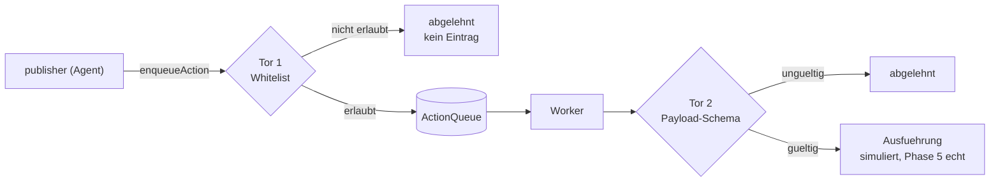

# Sicherheitsmodell — MOAT

> Welche Schichten es gibt, welche Bedrohung jede abwehren soll, und — der wichtigste Teil —
> **welche davon heute wirklich greift und welche nicht.**
>
> Eine Sicherheitsdokumentation, die nur die Absicht beschreibt, ist eine Gefahr: sie erzeugt
> Vertrauen, das der Code nicht deckt.

---

## 1. Die vier Schichten

| Schicht | Was sie abwehrt | Datei | Greift heute |
|---|---|---|---|
| **L1 · Eingabe-Guardrail** | Prompt-Injection, Budget-Ausreißer | `src/kernel/security/guardrail.js` (Engine) · Muster in `src/domains/report/domain.js` | 🟡 teilweise |
| **L2 · Rate-Limit** | Missbrauch, Kostenexplosion durch Volumen | `src/kernel/security/rateLimiter.js` | 🟢 ja |
| **L3 · Authentifizierung** | Unbefugter Zugriff | `src/kernel/security/auth.js` | 🟡 teilweise |
| **L4 · Aktions-Isolation** | Datenabfluss, Spam durch einen gekaperten Agenten | `src/kernel/security/actionQueue.js` (Mechanik) · Whitelist in `src/domains/report/actions.js` | 🟢 ja |

Dazu quer über alle Schichten: der **Budget-Kill-Switch** in `src/kernel/observability/costTracker.js`,
abgefragt vom Guardrail als allererster Schritt.

## 2. Bedrohungsmodell

Wogegen dieses System sich verteidigt — und wogegen ausdrücklich nicht.

### Im Modell

| # | Bedrohung | Abwehr |
|---|---|---|
| B1 | **Prompt-Injection über die Aufgabe** — die Eingabe versucht, den Agenten umzusteuern | L1, ohne LLM (ADR-0003) |
| B2 | **Datenabfluss durch einen Agenten** — das Modell wird überredet, Inhalte nach außen zu senden | L4: der Agent hat keinen Netzzugriff, nur eine Queue |
| B3 | **Werkzeugmissbrauch** — eine erlaubte Aktion wird mit bösartigem Payload aufgerufen | L4, zweites Tor: Payload-Validierung im Worker |
| B4 | **Kostenangriff** — viele oder teure Läufe erzeugen eine hohe Rechnung | Budget-Kill-Switch + L2, nach Endpunkt gestaffelt |
| B5 | **Unbefugter Zugriff** | L3, `x-api-key` nur aus dem Header |
| B6 | **Veröffentlichung ohne menschliche Freigabe** | HITL: `interruptBefore` vor `human_approval` |

### Ausdrücklich außerhalb des Modells (v1)

- **Mandantentrennung.** Es gibt einen Tenant, kein `tenantId` in Abfragen.
- **Schutz gegen einen bösartigen Betreiber.** Wer den API-Key hat, darf alles.
- **Persistenz-Angriffe.** Der Speicher liegt im RAM; es gibt keine Datenbank anzugreifen —
  aber auch nichts, was einen Neustart überlebt.
- **Vergiftete externe Daten.** Der `researcher` ruft heute nichts Externes ab. Sobald er das
  tut, muss dieselbe Sanitisierung wie bei der Nutzereingabe greifen: **externe Daten sind
  ebenso feindlich.**

## 3. L1 — Eingabe-Guardrail

Läuft als erster Knoten jedes Workflows. **Kein LLM**, reine Regex-Bewertung — die
Sicherheitsprüfung selbst darf nicht injizierbar sein (ADR-0003).

| Gewicht | Muster |
|---|---|
| 3 | `ignore previous instructions`, `jailbreak`, `DAN mode`, `</system>` |
| 2 | `you are now a`, `pretend to be`, `act as a` |
| 2 | `[INST]`, `### system`, `<\|…\|>` |
| 1 | `malware`, `sql injection`, `xss`, `drop table` |

Drei Ausgänge: `>= 8` blockieren · `>= 3` sanitisieren und fortfahren · sonst durchlassen.
Zusätzlich wird die Eingabe auf 3000 Zeichen gekürzt.

> ✅ **Eingelöst seit Phase 2 (T2.4).** Ein Key mit ungültigen Zeichen wird nicht mehr
> bereinigt, sondern gegen `/^[A-Za-z0-9-_.]{1,128}$/` geprüft und sonst mit **401**
> abgelehnt. Der Vergleich läuft laufzeitkonstant (beide Seiten werden gehasht, damit
> auch die Länge nichts verrät). `req.clientId` trägt jetzt den **gesendeten** Wert, also
> stimmen Rate-Limit und Audit wieder mit der tatsächlichen Eingabe überein.
>
> Verifiziert durch Ausführen, acht Fälle: gültiger Key 200; ungültige Zeichen,
> Leerzeichen-Polsterung, Injection-Versuch, falsche Schreibweise, fehlender Header,
> 129 Zeichen und ein Präfix des echten Keys jeweils 401.
## 4. L2 — Rate-Limit, nach Endpunkt gestaffelt

Ein einziges globales Limit reicht nicht: teure und billige Endpunkte gehören in getrennte
Eimer.

| Limiter | Grenze/Minute | Wo |
|---|---|---|
| `globalLimiter` | 120 | alle `/api`-Routen |
| `workflowLimiter` | 10 | `POST /api/run` — löst LLM-Aufrufe aus |
| `approveLimiter` | 20 | `POST /api/approve` |

Schlüssel ist `req.clientId` (nach der Auth) oder ersatzweise die IP.

> ⚠️ **Zu beachten:** `globalLimiter` hängt **vor** der Auth in der Kette. Dort ist
> `req.clientId` noch nicht gesetzt, der globale Limiter zählt also faktisch nach IP.
> Das ist nicht falsch, aber es ist nicht das, was der Code auf den ersten Blick verspricht.

## 5. L3 — Authentifizierung, fail-closed

Regeln: Der Key wird **ausschließlich** aus dem Header `x-api-key` gelesen — nicht aus Body
oder Query, was „Key Smuggling" ausschließt. Unbekannter Key → 401, kein automatisches
Anlegen eines Tenants.

> ✅ **Eingelöst seit Phase 2 (T2.4).** Ein Key mit ungültigen Zeichen wird nicht mehr
> bereinigt, sondern gegen `/^[A-Za-z0-9-_.]{1,128}$/` geprüft und sonst mit **401**
> abgelehnt. Der Vergleich läuft laufzeitkonstant (beide Seiten werden gehasht, damit
> auch die Länge nichts verrät). `req.clientId` trägt jetzt den **gesendeten** Wert, also
> stimmen Rate-Limit und Audit wieder mit der tatsächlichen Eingabe überein.
>
> Verifiziert durch Ausführen, acht Fälle: gültiger Key 200; ungültige Zeichen,
> Leerzeichen-Polsterung, Injection-Versuch, falsche Schreibweise, fehlender Header,
> 129 Zeichen und ein Präfix des echten Keys jeweils 401.

## 6. L4 — Aktions-Isolation

### Abb. 5 · Zwei Tore zwischen Agent und Aussenwelt



Der Agent erreicht die Aussenwelt an keiner Stelle direkt. Die Angriffsflaeche schrumpft von
„alles, was das Netz erlaubt" auf drei validierte Formen.

**Das wichtigste Muster des Systems.** Agenten rufen niemals direkt eine externe API auf.

```
Agent → ActionQueue (schreibt nur) → Worker (liest, validiert, führt aus)
```

**Tor 1 — beim Einreihen.** Steht der `actionType` nicht auf der Whitelist
(`NOTIFY`, `WEBHOOK`, `EMAIL`), wirft `enqueueAction` — noch bevor irgendetwas geschrieben wird.

**Tor 2 — beim Ausführen.** Je Typ ein Validierer:

| Typ | Bedingung |
|---|---|
| `NOTIFY` | `text` ist ein String, höchstens 1000 Zeichen |
| `WEBHOOK` | `url` ist ein String und beginnt mit `https://` |
| `EMAIL` | `to` enthält `@`, `body` höchstens 5000 Zeichen |

Scheitert die Validierung → `REJECTED`. Bei einem Fehler in der Ausführung → nach drei
Versuchen `FAILED`.

**Der Sicherheitsgewinn:** Die Angriffsfläche eines gekaperten Agenten schrumpft von
„alles, was das Netz erlaubt" auf drei schemabegrenzte Formen. Selbst ein vollständig
übernommenes Modell kann weder eine beliebige URL aufrufen noch beliebige Daten senden.

**Heute simuliert der Worker nur.** Bevor echte Executor angeschlossen werden, muss Phase 2
abgeschlossen sein — siehe §7.

## 7. HITL: die zentrale Zusage

Die Zusage lautet: **keine nach außen wirkende Aktion ohne menschliche Genehmigung.**
Umgesetzt über `interruptBefore` vor `human_approval`.

> ✅ **Eingelöst seit Phase 2 (T2.3).** Die Kante `human_approval → publisher` ist bedingt
> und **fail-closed**: nur `humanApproval === true` führt zum `publisher`; `false` und
> `null` führen nach END.
>
> Verifiziert durch Ausführen mit `approved: false` — Artefaktstatus bleibt
> `AWAITING_APPROVAL`, die Queue ist leer, der Runner meldet `REJECTED`.
>
> **Echte Executor bleiben trotzdem außerhalb von v1** (`PRODUCT.md` §5.2). Die Zusage
> gilt jetzt im Code; ihre Messung entsteht erst in Phase 3 (`EVALS.md` §3.1–3.2).

## 8. Zusammenfassung: worauf man sich heute verlassen kann

| Zusage | Status |
|---|---|
| Agenten haben keinen direkten Netzzugriff | 🟢 gilt |
| Aktionen sind auf drei validierte Typen begrenzt | 🟢 gilt |
| Teure Endpunkte sind strenger limitiert | 🟢 gilt |
| Ein Budgetüberschuss stoppt weitere LLM-Aufrufe | 🟢 gilt |
| Der API-Key wird nur aus dem Header gelesen | 🟢 gilt |
| Ein ungültiger Key wird abgelehnt | 🟢 gilt seit T2.4 |
| Injection-Versuche werden blockiert | 🔴 Schwelle unerreichbar |
| Eine Ablehnung verhindert die Veröffentlichung | 🟢 gilt seit T2.3 |

Sieben von acht Zusagen gelten. Der eine rote Punkt — die unerreichbare
Guardrail-Schwelle — ist kein blockierender Defekt aus Phase 0, sondern eine der
kleineren Korrekturen; sein Zustand steht in `PRODUCT.md` §6.1 und wird ab Phase 3 in
`EVALS.md` §3.5 gemessen.
