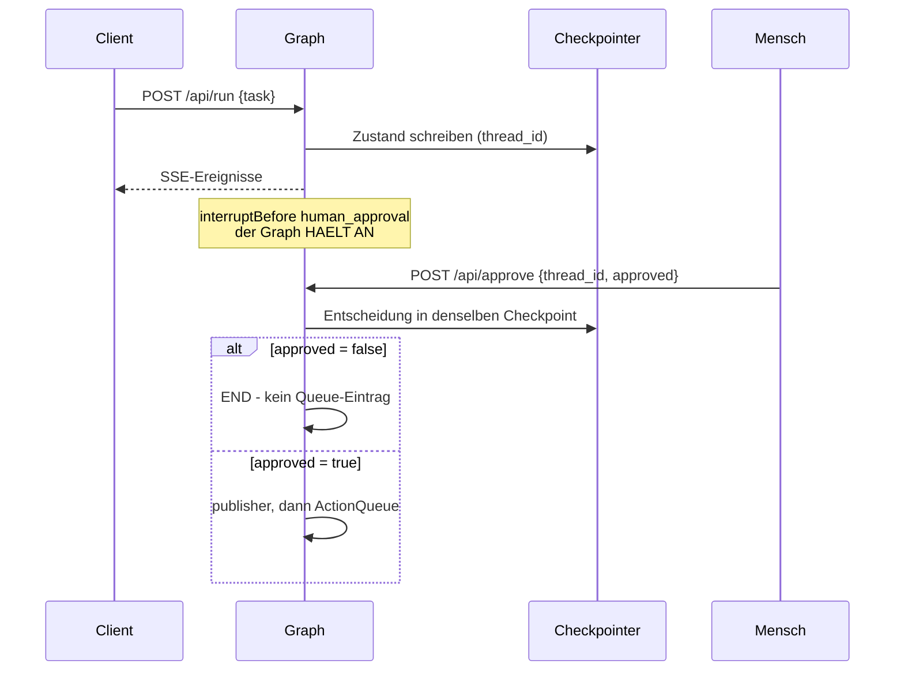

# Workflow — Ablauf Knoten für Knoten

> Was in welcher Reihenfolge passiert, welcher Knoten welches State-Feld liest und schreibt,
> und wie das Anhalten und Fortsetzen bei der menschlichen Genehmigung technisch funktioniert.
>
> Das Gesamtbild und die Begründungen stehen in `ARCHITECTURE.md`.

---

## 1. Der goldene Pfad

```
START
  └→ guardrail          prüft die Eingabe, kein LLM
      └→ orchestrator   BREMSE 4: keine Recherche
          └→ researcher
              └→ orchestrator   BREMSE 5: Recherche da, kein Entwurf
                  └→ writer
                      └→ orchestrator   BREMSE 6: Entwurf da, keine Freigabe
                          └→ critic
                              └→ orchestrator   BREMSE 7: freigegeben
                                  └→ fileSaver
                                      └→ orchestrator   BREMSE 2: Datei bereit
                                          ⛔ HÄLT AN vor human_approval
                                              ↓ POST /api/approve
                                          └→ publisher → END
```

Der `orchestrator` erscheint zwischen je zwei Agenten. Das ist Hub-and-Spoke: kein Agent
kennt seinen Nachfolger.

## 2. Was jeder Knoten liest und schreibt

| Knoten | Liest | Schreibt | LLM |
|---|---|---|---|
| `guardrail` | `task`, Budgetstatus | `task` (ggf. bereinigt), `threatScore`, `nextAgent` | nein |
| `orchestrator` | den gesamten State | `nextAgent` | nur wenn keine Bremse greift |
| `researcher` | `task` | `research` | ja |
| `writer` | `task`, `research`, `criticFeedback` | `draft`, `revisionCount +1`, `isApproved = null` | ja |
| `critic` | `task`, `draft` | `isApproved`, `criticFeedback` | ja (strukturiert) |
| `fileSaver` | `threadId`, `task`, `draft` | `fileSaved = true`, Artefakt im Store | nein |
| `human_approval` | — | — (leerer Platzhalter) | nein |
| `publisher` | `threadId`, `task` | `isPublished = true`, Eintrag in der ActionQueue | nein |

Jeder Knoten schreibt zusätzlich nach `log[]`. Daraus erzeugt der Runner die SSE-Events —
`log[]` ist die Trace-Grundlage der gesamten Evaluation.

## 3. Der Guardrail: drei Ausgänge

Er läuft als **erster** Knoten, weil er nichts kostet und deshalb auch den Budget-Kill-Switch
tragen kann.

```
Budget überschritten?  → END, kein einziger LLM-Aufruf
Score >= 3             → END, blockiert
Score >= 2             → sanitisieren und weiter
sonst                  → weiter
```

Gewichtete Regeln: 3 (Jailbreak-Muster) · 2 (Rollenübernahme) · 2 (Instruktions-Marker) ·
1 (Angriffsvokabular).

> ✅ **Behoben in Phase 5.** Bis dahin lag die Blockierschwelle bei 8 — genau der Summe aller
> Gewichte. Blockiert wurde also nur, wenn **alle vier** Regeln zugleich griffen; ein üblicher
> Injection-Versuch (Score 3) lief sanitisiert weiter. Jetzt gilt: **≥ 3 blockiert · 2
> sanitisiert · 1 durchgelassen.** Das unterste Band ist Absicht — „malware" oder „sql
> injection" sind legitime Berichtsthemen, und Metrik 3.5 misst beide Seiten.
>
> Mit der Schwelle wurde auch die Sanitisierung nachgezogen: sie maskierte nur das
> 3er-Muster. Da dieses Band jetzt blockiert, hätte das Log „sanitisiert" gemeldet, ohne dass
> ein Zeichen des Textes anders gewesen wäre. Sie deckt nun die Muster ab, die im 2er-Band
> tatsächlich greifen.

## 4. Die Reihenfolge der Bremsen ist die Regel

Der `orchestrator` prüft sieben Bedingungen **in dieser Reihenfolge** und nimmt die erste,
die zutrifft. Die Reihenfolge ist die eigentliche Geschäftslogik:

| # | Bedingung | Ziel | Warum an dieser Stelle |
|---|---|---|---|
| 1 | `isPublished` | `END` | Nach der Veröffentlichung darf nichts mehr laufen |
| 2 | `fileSaved && humanApproval == null` | `human_approval` | Vor allem anderen: der Mensch entscheidet |
| 3 | `revisionCount >= 5` | `human_approval` | Schutzschalter gegen endlose Revision |
| 4 | `!research` | `researcher` | Ohne Material kein Entwurf |
| 5 | `research && !draft` | `writer` | Material da, jetzt schreiben |
| 6 | `draft && isApproved !== true` | `critic` | Entwurf muss geprüft werden |
| 7 | `draft && isApproved === true && !fileSaved` | `fileSaver` | Freigegeben, jetzt sichern |

Bremse 2 steht bewusst weit oben: Sobald ein Artefakt existiert, hat die menschliche
Entscheidung Vorrang vor jeder weiteren Produktion.

Greift keine Bremse, entscheidet das LLM mit einem Zod-Schema — und die Antwort wird gegen
`VALID_AGENTS` geprüft, sonst Override auf `END`.

> 🔴 **Bekannter Defekt (Phase 2):** Bremse 6 unterscheidet nicht zwischen „noch nicht
> geprüft" (`isApproved === null`) und „abgelehnt" (`isApproved === false`). Nach einer
> Ablehnung führt kein Weg zurück zum `writer` — der `critic` ruft sich selbst auf, bis
> LangGraph das Rekursionslimit zieht. Folgefehler: `revisionCount` wird nur im `writer`
> erhöht, bleibt also bei 1, und **Bremse 3 greift nie**.
>
> Die Korrektur teilt Bremse 6: `=== null` → `critic`, `=== false` → `writer`.

## 5. HITL: Anhalten und Fortsetzen

### Abb. 4 · Zwei HTTP-Anfragen, ein Checkpoint



> Der `alt`-Block ist seit Phase 2 (T2.3) im Code umgesetzt: die Kante
> `human_approval → publisher` ist bedingt und fail-closed. Verifiziert durch Ausführen —
> nach `approved:false` bleibt das Artefakt `AWAITING_APPROVAL` und die Queue ist leer.

Der Graph wird mit `interruptBefore: ["human_approval"]` kompiliert. Er hält an, **bevor** er
den Knoten betritt — der Knoten selbst ist ein leerer Platzhalter, seine einzige Funktion ist,
die Haltestelle zu markieren.

**Erste Anfrage** (`POST /api/run`):

```
startWorkflow({ task, threadId })
  → app.stream({ task, threadId }, { configurable: { thread_id } })
  → läuft bis human_approval, hält an
  → getState().next enthält "human_approval"
  → SSE: workflow_complete / AWAITING_APPROVAL
```

**Zweite Anfrage** (`POST /api/approve`):

```
resolveApproval({ threadId, approved })
  → app.updateState(config, { humanApproval: approved })     // in denselben Checkpoint
  → app.stream(null, config)                                  // null = fortsetzen
  → bedingte Kante: true → publisher → END, sonst direkt END
  → SSE: workflow_complete / PUBLISHED bzw. REJECTED
```

**Der entscheidende Punkt ist die `thread_id`.** Beide Anfragen adressieren denselben
Checkpoint. Ein `stream(null, config)` heißt „mach am Checkpoint weiter", kein Neustart.

> **Und seit Phase 5 (T11) überlebt dieser Checkpoint auch einen echten Neustart.** Bis
> dahin lag er im `MemorySaver`, also im Arbeitsspeicher — „zwischen zwei Anfragen" war
> damit stillschweigend auf „solange der Prozess lebt" begrenzt, und genau das ist bei einer
> Genehmigung, auf die ein Mensch erst am nächsten Tag schaut, die falsche Grenze.
> `DateiCheckpointer` (ADR-0027) erbt von `MemorySaver` und ergänzt nur Anhängen und
> Abspielen; das Protokoll selbst wird nicht nachgebaut. Nachweis:
> `tests/integration/persistence.test.js` startet **zwei echte Prozesse** — der zweite kennt
> vom ersten nichts als das Verzeichnis.

> **Behoben in Phase 2 (T2.3).** Die Kante `human_approval → publisher` ist jetzt bedingt
> und **fail-closed**: nur `humanApproval === true` führt zum `publisher`, `false` und
> `null` führen nach END. Der Runner meldet bei einer Ablehnung `REJECTED`.
>
> Eine Ablehnung ist damit **endgültig**. Sie in eine neue Revisionsrunde zu führen wäre
> ein eigenes Merkmal — `fileSaved` und `humanApproval` müssten zurückgesetzt werden —
> und ist bewusst nicht Teil von v1.

## 6. SSE-Events

Der Runner sendet pro Knotenübergang:

| Event | Wann | Inhalt |
|---|---|---|
| `agent_log` | je Zeile in `log[]` | `node`, `line` |
| `agent_active` | nach jedem Knoten | `node` |
| `workflow_complete` | am Ende oder beim Anhalten | `status` |

`status` ist `AWAITING_APPROVAL` (angehalten), `DONE` (durchgelaufen), `PUBLISHED` (nach
Genehmigung) oder `REVISED` (nach Ablehnung — derzeit irreführend, siehe §5).

**Event-Buffering:** Der Workflow erzeugt Events, bevor der Browser die SSE-Verbindung
geöffnet hat. Ohne Zuhörer wandern sie in einen Puffer und werden beim Verbinden abgespielt.
Ein GC räumt nach 5 Minuten auf — allerdings nur am Ende von `startWorkflow`, nicht nach
`resolveApproval` (kleines Leck, Phase 2).

## 7. Ein vollständiger Lauf, wie er aussehen soll

Nach der Korrektur von Bremse 6 (Phase 2) sieht der Mock-Lauf so aus — der Mock-Critic gibt
ab der zweiten Revision frei, damit das Ende der Schleife sichtbar wird:

```
✅ guardrail: sauber
🧠 BREMSE4: keine Recherche → researcher
🔎 researcher: Recherche abgeschlossen
🧠 BREMSE5: Recherche da, kein Entwurf → writer
✍️ writer: Entwurf erstellt (Revision 1)
🧠 BREMSE6a: Entwurf da, ungeprüft → critic
🧪 critic: Revision gefordert
🧠 BREMSE6b: abgelehnt → writer
✍️ writer: Entwurf erstellt (Revision 2)
🧠 BREMSE6a: Entwurf da, ungeprüft → critic
🧪 critic: FREIGEGEBEN
🧠 BREMSE7: freigegeben → fileSaver
💾 fileSaver: Artefakt gespeichert (AWAITING_APPROVAL)
🧠 BREMSE2: Datei bereit → menschliche Genehmigung
=== workflow_complete: AWAITING_APPROVAL ===
```

**Seit T2.2 und T2.3 endet der Lauf genau so.** Verifiziert durch Ausführen: `npm run demo`
liefert Exit 0 und nach der Genehmigung `PUBLISHED`; mit `approved:false` bleibt das
Artefakt `AWAITING_APPROVAL` und die Queue ist leer. Die rote Baseline dazu steht
unverändert in `PRODUCT.md` §6.1.
